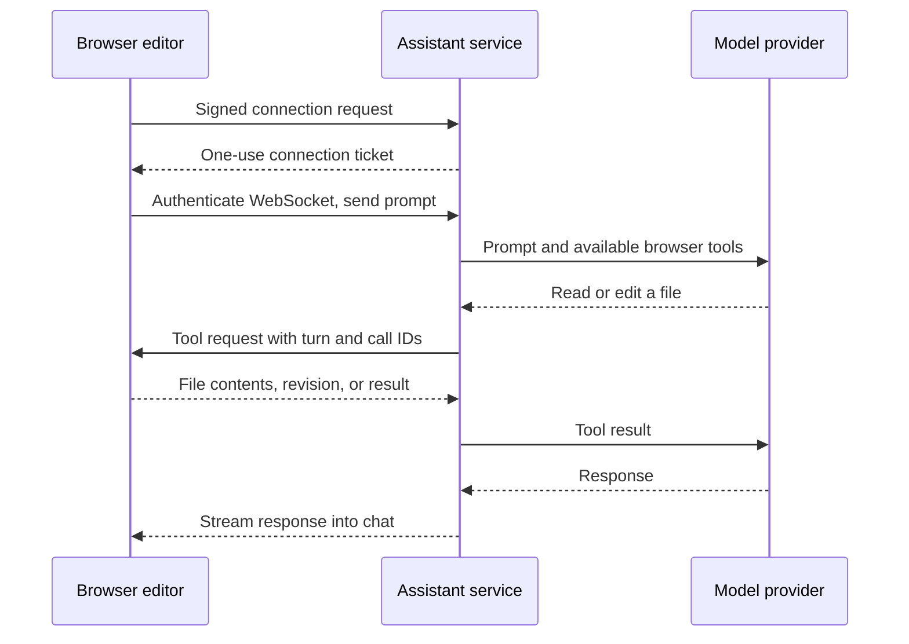

# Web assistant

The browser owns the open project. A Node service runs pi's agent loop with Claude or
Codex OAuth and asks the browser to execute tools over a WebSocket. It never creates
a server workspace. Files imported from a computer follow exactly the same path as
projects created in the browser; the original folder on the computer is unchanged.



Only requested file contents, scene context, and attached images go through the
assistant to the model. This is separate from account sync, which continues copying
project files to private storage as before. The service's OAuth session stays on the
server. All permitted wallets use that operator's subscription; this version does
not provide per-user provider login or usage accounting.

## Deploy with a Claude setup token

Run `claude setup-token` once on your computer, then save the result in your
deployment's secret manager as `ANTHROPIC_OAUTH_SETUP_TOKEN`. Claude documents this
as a one-year token for unattended model requests ([authentication docs](https://code.claude.com/docs/en/authentication#generate-a-long-lived-token)).
The variable is read only by the Node service; never add it to the web bundle.

For local development, put the token in `packages/service/.env` as
`ANTHROPIC_OAUTH_SETUP_TOKEN=…`. The service loads that file automatically through
its config component. Injected environment variables override the file.
The [container deployment guide](../packages/service/README.md#container-deployment)
covers the Dockerfile, Compose, persistent storage, and production ingress.

```bash
# ANTHROPIC_OAUTH_SETUP_TOKEN is injected by the deployment platform.
node packages/service/dev-server.ts --host 0.0.0.0 --port 8787 \
  --data /data/projects --origin https://your-editor.example
```

At startup, the service saves that token as an OAuth access credential in
`<data>/../.assistant/.auth.json` (mode 0600), or the path supplied with `--ai-auth`.
It preserves other providers' sessions. Changing the secret and restarting rotates
Claude's credential; restarting with the same token preserves its recorded expiry.
A setup token has no refresh token: replace it when it expires or is revoked.
The provider controls actual expiry; redeploying does not renew the token.

Keep that file out of the project data: pass `--ai-auth` (or `AI_AUTH_PATH`) pointing at a
secret mount, or the service warns at startup. In production (`NODE_ENV=production`) the service
refuses to start the assistant without `ASSISTANT_WALLETS` (a wallet list, or `*`), and caps turns
with `ASSISTANT_TURNS_PER_MINUTE` (all wallets) and `ASSISTANT_TURNS_PER_DAY` (per wallet).

Thumbnails use a second OAuth file, a ChatGPT (Codex) session: run
`npm run -w @dcl-editor/service image-login -- --out /absolute/path/image-auth.json` where a browser
can complete the sign-in (or choose the device-code login on a headless machine), copy the file to a
secret mount outside `STORAGE_DIR` with mode 0600, and set `AI_IMAGE_AUTH_PATH` (`--ai-image-auth`
for `dev-server.ts`). The service refreshes the token in that file. Production refuses a path inside
`STORAGE_DIR`.

## Run locally with browser sign-in

From the repository root, with Node 24 and dependencies installed:

```bash
node packages/service/scripts/assistant-login.ts --provider claude --auth /absolute/path/.auth.json
# Or --provider codex. Complete the OAuth flow in your browser.

node packages/service/dev-server.ts --port 8787 --data /tmp/dcl-projects \
  --origin http://localhost:5230 --ai-auth /absolute/path/.auth.json
# Optional: --ai-model <model-id> replaces claude-opus-5-5, the only model the assistant uses.

npm run build -w @dcl-editor/web
```

The sign-in command stores an OAuth session using pi's credential format. An existing
compatible session file can be passed directly to `--ai-auth`; token refresh is
handled by pi. API-key authentication is disabled for both providers in the service.

Serve the web editor from the bevy-web host with its v1 `services.projects` URL
pointing at this service and sign in to Decentraland. The assistant shares the
host's signed-fetch identity and the existing chat/Script Studio UI. Select an
entity and ask for a behavior, or explicitly ask to edit `src/index.ts` for a
scene-wide change. **Recheck** refreshes the available providers after sign-in.

Without `--ai-auth` or the setup-token secret, the service answers assistant routes with 503 and the chat
shows that the service is unavailable. A v0 host or a host without a project-service
URL keeps its previous code-only UI. Cloudflare's project-storage Worker does not
host the assistant; it currently requires the Node entry point and WebSocket upgrades.

If a local scene builds but stays at **Connecting to scene…**, check the Explorer
bridge server as well as the editor bundle. The bridge must come from the host
checkout that implements `editorScene` messages. A different worktree already
serving port 8100 can be silently reused. Start the matching bridge on an unused
port and select it with `?systemScene=http://localhost:<port>` on the editor URL.

## Decentraland SDK skills

The service ships 22 SDK skills and 72 guidance/reference documents from a pinned
snapshot of `decentraland/sdk-skills`. The model sees the topic catalog and uses
`read_skill` to load relevant guidance before writing SDK code. Large documents
are paginated; asset catalogs support literal text search. No runtime download or
new secret is needed, and the Docker image includes the same snapshot.

The skill reader is a Well-Known Component injected into the agent factory. It
reads only the packaged document map, never arbitrary paths on the server. These
skills add SDK knowledge; they do not add shell, network, MCP, image download,
file-storage or publishing tools. The browser's asset tool imports catalog models and
library prefabs; other external assets require the creator's import. Desktop-only workflows are omitted, and the web prompt adapts script paths
and entity edits to the editor's own tools.

Source pin, license and update instructions: [service skills](../packages/service/skills/README.md).

## Tools and lifecycle

The Node entry point uses Decentraland Well-Known Components, following
`world-storage-service`: typed dependencies in `src/types.ts`, construction in
`src/components.ts`, routing in `src/controllers/routes.ts`, and startup in
`src/service.ts`. The shared HTTP server handles WebSocket upgrades. Its lifecycle
closes sessions and cancels pending browser calls before stopping HTTP and draining
the purge job. Configuration, logging, health probes and metrics use the shared
components; see the [service README](../packages/service/README.md).

- `list_files`: project paths filtered by kind and name, including models and media.
- `read_file`: readable project text, excluding hidden paths, credentials, dependencies
  and build output. Reads are limited to 256 KiB each.
- `asset_request`: search and import library prefabs, or inspect a project model's bounds
  and resources. Imports require edit mode. Catalog models go through `scene_request`
  `findModels` and `placeModel`; a `findModels` search runs alongside queued scene edits.
- `write_file`: source code under `src/`, excluding generated runtime directories.
  An edit must supply the revision returned by a read; creating a file requires
  `revision: null` and an absent path. A concurrent change rejects the write.
  File checks and writes share the editor's write queue. A new `src/scripts/` file
  is attached right away to the entity selected when the turn began,
  and the result names it as `attached`; later writes in the turn refresh its
  parameters. The desktop CLI attaches new scripts when its turn ends instead.
- `scene_request`: inspect, create an entity, set an authorable component, attach
  a script, set script parameters, or place an existing prefab. These use the same
  editor actions as the UI, with undo and autosave. Component replacement requires
  the previously inspected value. Mutations require edit mode.
  `buildModel` runs a three.js script the assistant writes and places the GLB it exports.
  The script runs in a worker inside a sandboxed frame with an origin of its own and a
  policy that allows no network; the page checks the reply (size caps, known material
  names) and counts the model from the GLB against a per-model budget (8,000 triangles,
  6 materials, 4 textures up to 512 px). It writes `models/<name>-<hash>.glb`, the script
  to `models/src/` (kept out of the published scene) and the shared materials it
  uses to `models/materials/T_<Name>_D.jpg` (colour, 1024 px) and `T_<Name>_N.jpg` (relief,
  512 px), Decentraland's naming, bundled with the editor; the worker never sees them. Each
  costs the scene's texture limit once, and a build that would push the scene over it is
  refused, as is any texture that is not a power of two. The build follows Decentraland's
  rules: double-sided parts become two front faces, vertex colours are removed, unnamed parts
  are named `<Model>_PartNN` and static parts sharing a material are merged. A rebuild keeps
  the previous file so undo still works; deleting a model also deletes material images
  nothing else uses, and Assets lists unused ones.
  `addSound` copies one of 25 CC0 sounds from Kenney's packs (mono mp3s, bundled with the editor
  beside the materials, fetched against their hashes) into `assets/audio/library/<name>.mp3` if it is not
  there yet, and answers its path, length and whether it loops. The prompt lists the names and has
  the assistant play them with an AudioSource: created once, retriggered with `AudioSource.playSound`.
  `packages/ui/scripts/pack-sounds.mjs` regenerates them; the packs have no wind, crowd, water or
  music loop, so the library has none.
  `check` also returns the scene's budget against the parcel limits and its deploy size.
- `build`: compile the current browser project, run the bundle once and return compiler
  diagnostics plus scene/client/server errors. This does not simulate a full playthrough.
- `view`: capture the viewport, optionally framing an entity or setting the camera pose.
  `target: 'mobile'` captures the open Godot mobile preview, including touch controls and scene UI,
  in the editor or a separate tab. Mobile capture uses the player's current camera. With no
  target or framing arguments, an embedded mobile preview is selected automatically;
  `target: 'editor'` always selects the editor camera.
  The turn context and build result include the current mobile preview mode and readiness.
  After HUD/menu/layout changes, the assistant is instructed to capture an open preview automatically
  after a successful build, check readability, clipping and overlap with touch controls, and recheck fixes.
  For automatic validation, a closed preview prompts an offer to check mobile. When the creator asks
  to see mobile UI, `view({ target: 'mobile', openIfClosed: true })` opens the preview if needed and waits
  up to 60 seconds for readiness. Failed captures are reported as incomplete. These are assistant instructions,
  not a deterministic visual test or a substitute for interaction testing.
  Asking how mobile controls or UI look also uses this capture, without requiring a build.
  A minimized preview briefly resumes for a fresh picture, then pauses again even if capture fails.
  It keeps the same instance and camera; a creator's mode change during capture takes precedence.
- `make_thumbnail` (runs on the service): paints the scene's key art with an image model. It takes
  2 `view` shots as references (the hero subject close, then the whole scene wide), with `avatars` adds a bundled
  line-up of Decentraland avatars (`src/ai/avatar-lineup.jpg`, so people look like avatars) and the
  creator's own avatar (the wallet's body snapshot from `peer.decentraland.org`, skipped when it
  can't be fetched, drawn as the lead character; without `avatars` the poster has no people), sends them with the assistant's brief, title and style plus
  Decentraland's composition rules (16:9, title and key subject inside the central square, no small
  text, UI, borders or watermarks) to the ChatGPT responses backend's `image_generation` tool, and
  asks the browser to save the result. The browser crops it to 1920×1080, encodes a jpg under 1 MB,
  saves it as a new version, `assets/images/thumbnail-N.jpg`, and sets `display.navmapThumbnail`.
  Each version shows as a card in the chat, with "Use this" to switch back to it. With `revise`, the
  current thumbnail goes along as the last reference and the model edits only what was asked;
  `scene_request {type:"useThumbnail",version}` switches versions without painting. Old versions
  stay in the project (and are published) until the creator deletes them. The reference shots
  and the image never enter the chat model's context; only an optional 384×216 preview does. It
  needs `AI_IMAGE_AUTH_PATH` (a separate ChatGPT session from `npm run -w @dcl-editor/service
  image-login -- --out <file>`), counts against `ASSISTANT_IMAGES_PER_DAY` (default 10 per wallet),
  and without the session tells the creator it is unavailable. The assistant offers one after the
  first build of a new game, and Scene checks warns about a built scene without one.
  There is no shell, package installation, deletion or publishing tool.
- `playtest`: start or stop Play, read the player's position, HUD and runtime errors,
  walk on the ground with the movement controller, press the E/F interaction keys,
  or click a viewport position. It cannot jump or steer with movement keys: routes
  that need a jump are left for the creator to try. Each movement or wait lasts at most five seconds. Stop restores the
  authored scene; playtest actions do not grant progress or teleport the player.
  A client reload can retain multiplayer server progress. Use the game's restart
  control and verify its initial HUD before testing a fresh attempt.
  The assistant plays only when the creator asks it to play or test something;
  otherwise `build` and `check` are its verification and the creator plays.
- `read_skill`: server-side, read-only SDK guidance from the bundled library, with
  at most 16,000 characters per page or 20 search matches. This never requests a
  browser file and cannot read credentials or private project storage.

A conversation runs in memory on one connection and stays with that browser's
project, provider and model. After each completed turn the service also keeps what
the model remembers, encrypted (AES-256-GCM) with a key only that browser holds, in
`<data>/../.assistant/memory/<wallet>/<id>.bin`. The browser sends the id and key with
each prompt; when a new connection (a reload, a reconnect, a service restart) starts the
conversation again, the service opens that file with the key and the model carries on
where it was. The key is never written on the service. A file unused for 14 days is
deleted, as is one over 8 MB; New chat deletes it while connected and always drops the key. A wallet keeps at most
20 (the least recently used goes), all of them together at most 2 GB (past that, nothing new
is kept). A save rejected by that cap preserves existing conversations, and a copy a connection
couldn't open is never written over. Save and deletion failures are logged under `assistant`
without conversation content or keys. Stop, New chat, project changes, account changes and
disconnects cancel outstanding requests. Project transitions drain any in-flight
browser action before opening another scene. Completed edits remain saved; an
interrupted request is never replayed automatically. When a turn reaches its time or
tool-result limit, the service keeps the conversation and the chat shows it as paused;
Continue sends a short continue prompt to that same conversation. If the connection
closed meanwhile, Continue starts the original request over and says so.

The chat itself is kept in the browser per wallet and project (OPFS
`dcl-editor/assistant/<project>@<wallet>.json`, the last 100 messages up to 256 KB,
without images) and comes back on reload under "Earlier conversation". Nothing in it is re-sent:
what the model remembers comes back from the service's encrypted copy instead.
Another wallet on the same browser never sees it; purging the project deletes it.
New chat (the assistant or Studio header) stops any turn and empties it.

The signed HTTP endpoints are `GET /assistant/providers` and
`POST /assistant/connect`. They use the same editor-only ADR-44 validation as project
storage and reject scene-signed requests. A connection ticket lasts 30 seconds, is
bound to the wallet and origin, and is presented as `dcl-ticket.<token>` alongside
`dcl-assistant-v1` in the `Sec-WebSocket-Protocol` upgrade header, never in a URL.
Only `dcl-assistant-v1` is echoed in the response. Authentication and connection
capacity are checked before the upgrade; there is no unauthenticated socket phase.
The endpoint is `/assistant/socket` under the configured base path. A reverse proxy
must preserve paths, origins, protocol headers and WebSocket upgrades, and must not
log credential headers. Deploy the updated browser client and service together.

Fixed limits: 32 connections per service, 3 per wallet, 10 turns and 10 connection
tickets per minute per wallet; 60 minutes per turn; 15 minutes per browser build, edit or write,
and 60 seconds per file read or listing. Browser calls are dispatched one at a time, so queued
work does not spend another action's timeout. Idle connections expire after 15 minutes; active
turns remain connected. These limits live in one process. Prompts allow four images of at most 2 MiB each.
Each turn's cost, priced at the model's API rates, counts against the wallet's daily and weekly
allowance (`ASSISTANT_DAILY_LIMIT`, `ASSISTANT_WEEKLY_LIMIT`), kept in `<data>/../.assistant/usage`.
The defaults are 50,000 per day and 200,000 per week, plus 50 turns per day
(`ASSISTANT_TURNS_PER_DAY`) and 2 running at once per wallet across its tabs (`ASSISTANT_TURNS_AT_ONCE`). Usage stays internal: the editor shows neither usage nor context
meters. A spent allowance refuses new turns until it resets, including in other open tabs.
Compaction calls count toward usage; completed conversation memory is saved even if a browser
disconnects while usage is being recorded.

## Validation

The browser also handles `asset_request`: `inspect_model` (project path), `search_prefabs` (query, offset), and
`import_prefab` (exact library/project ref). Imports require edit mode and do not place entities. A prefab import
returns the actual project folder and guide; `inspect_model` returns transformed static bounds, animation names and
resource warnings. The service does not download assets or hold a project filesystem.

Assistant limit and timeout regression tests (no model calls):

```bash
npx vitest run packages/service/src/ai/connection-limits.test.ts packages/service/src/ai/pi.test.ts packages/ui/src/features/ai/error-details.test.ts
```

These cover long prompts, multiple tabs, allowance resets, disconnects during accounting,
compaction costs, queued calls, slow builds/scene edits and duplicate hosted errors.

```bash
npm run validate
npm run validate -w @dcl-editor/web
npm run validate:assistant -w @dcl-editor/web # just the assistant browser checks

# Optional real model test: uses a synthetic project and the supplied OAuth session.
ASSISTANT_LIVE_AUTH=/absolute/path/.auth.json node packages/web/validate/smoke.mjs
# Optional ASSISTANT_LIVE_MODEL=<model-id>, SMOKE_SCREENSHOTS=/tmp/editor-shots
```

Unit tests cover stale writes, path restrictions, cancellation, request correlation,
timeouts, editor-only authentication and single-use tickets. Component integration
tests also cover storage responses, CORS, metrics and shutdown during a tool call.
The browser smoke test uses a deterministic agent behind the real component
lifecycle and signed HTTP/WebSocket transport, with a separate browser origin. It
reads and edits `src/index.ts`, builds in the browser, and verifies the saved OPFS file
and chat response. It restarts the service and reopens the project to check memory restoration,
then clicks New chat in the assistant and Script Studio to verify the encrypted file and
browser key are deleted. It also verifies account sync and publishing still work. It uses a
fake engine host; real-engine gates remain in bevy-web's `react-web/e2e/`.

Implementation: `packages/service/src/ai/` runs the agent and transport;
`packages/web/src/ai/` handles tools and scene actions;
`packages/contract/src/assistant.ts` defines their messages.

### Real preview checks with the running service

Open a project in a local Chromium preview with remote debugging enabled. Keep the
service running with its existing OAuth session. The harness attaches to that browser;
it does not load credential files, restart the service or close the browser.

```bash
npm run validate:preview -w @dcl-editor/web -- --cdp http://127.0.0.1:9222 --out /tmp/preview-check
# Optional model run, through the open assistant panel and its selected provider:
npm run validate:preview -w @dcl-editor/web -- --cdp http://127.0.0.1:9222 --prompt /tmp/game-prompt.txt --timeout 600
```

The default run makes no model calls. It checks engine connectivity and three consecutive
engine screenshots, failing early on nearly black captures. Use a lit scene for this check.
This catches the WebGPU screenshot regression before an assistant spends a turn debugging
scene content. Pass `--frame` if the engine page does not use `/app.html`.

Add `--scenario /tmp/game-checks.json` to replay gameplay in the current scene state:

```json
{"steps":[{"name":"Initial HUD","hud":["ORBS","CHECKPOINT"],"durationMs":300},{"name":"Walk to first platform","keys":["w"],"durationMs":500,"position":{"x":2,"y":3,"z":4,"tolerance":1}}]}
```

Use coordinates and HUD strings observed in your saved fixture; the example is only the
format. Each step requires an assertion; `notHud` rejects forbidden HUD text.
Optional `hidden` and `shown` lists assert entity
visibility, including propagation to child meshes. Keys are dispatched to the engine canvas and use normal player physics;
`click: {x,y}` uses viewport pixels. `walk: {x,y,z}` targets a world position; add
`jump: true` to steer a physical jump relative to the camera. `toward: {x,y,z}`
holds camera-relative movement keys toward that world point for `durationMs`, useful
for walking off a known ledge regardless of the camera orientation. `settleMs` waits
after input before checking the landing or HUD. Durations are bounded to five seconds and held keys release on failure.
The harness never teleports the player. Start Play before replaying movement checks.

Output is a small pass/fail summary. `report.json` contains timings, tool counts and
observed gameplay state; screenshots are saved only on failure. An assistant finishing
its turn does **not** prove the game works: the report separately counts gameplay assertions.
The [Sky Lantern Run fixture](../packages/web/validate/fixtures/sky-lantern-run-acceptance/README.md)
is a scene from one blank-scene prompt with complete, restart and incomplete-run replays: import its
`scene.zip`, start Play, and pass each JSON file as `--scenario`. Jump steering accounts for momentum;
aim at platform centres and inspect failed movement before changing the authored scene.
